# PinballY Expansion Pack

Extension non officielle de [PinballY](http://mjrnet.org/pinscape/PinballY.php), écrite avec l'API de scripting JavaScript que PinballY ouvre à tous les développeurs. · *[English version](README.md)*

> **Votre pincab, en français, avec de vraies raisons d'y revenir.** Ce qui manquait à PinballY, sans toucher à PinballY :
> - un Profil avec avatar pour chacun, et vos statistiques ;
> - un écran d'accueil avec la table du jour ;
> - des défis hebdomadaires ;
> - un niveau de maîtrise sur chaque table ;
> - des succès du Bronze au Platine, dont quelques secrets, qui font monter votre niveau.
>
> [Et la suite arrive…](#à-venir)

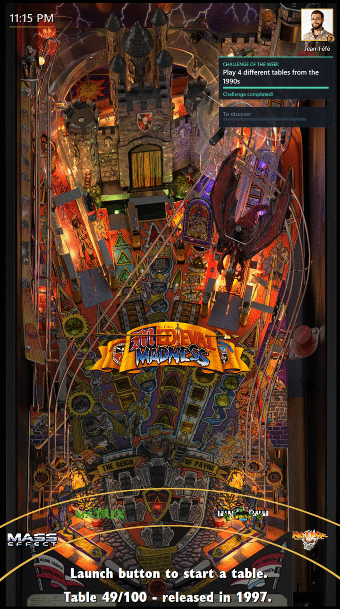

### PinballY en 6 langues

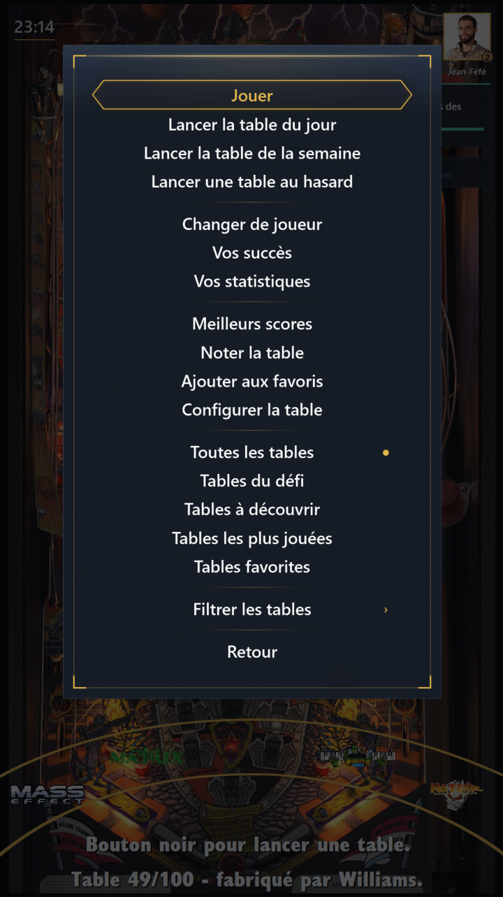

Les menus et messages de PinballY enfin en français, mais aussi en allemand, espagnol, italien et portugais.

### Un Profil pour chacun

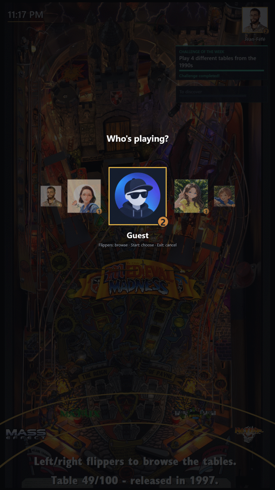

Avec « Changer de joueur », chacun prend son Profil et son Avatar, et l'écran d'accueil vous salue par votre nom : vous savez pour qui les parties vont compter. Seules les parties d'au moins une minute comptent : un lancement par erreur ne fausse rien. Vos jours d'affilée sur la borne comptent les jours de suite où vous avez joué, sur n'importe quelle table. Le Profil Invité reste toujours là pour les visiteurs. Dès que la borne compte au moins deux Profils sans compter Invité, PinballY démarre sur « Changer de joueur », pour que chacun choisisse son Profil avant de jouer ; il peut aussi démarrer sur l'écran d'accueil ou directement sur la roue (`STARTUP_SCREEN`, plus bas).

### Mon profil

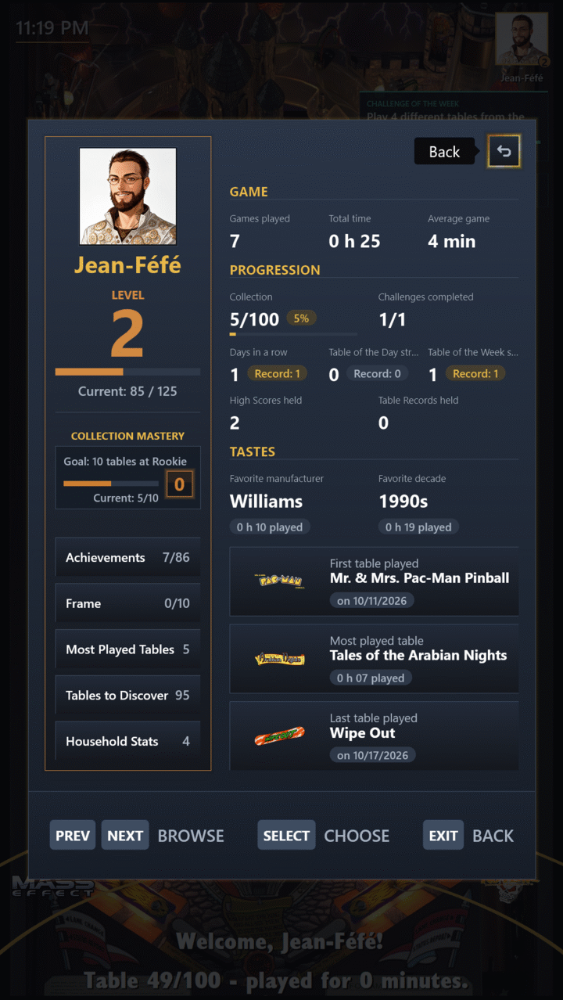

**Mon profil**, dans le menu principal, résume votre vie de flippeur :
- parties jouées, temps total et durée moyenne d'une partie ;
- votre niveau et la maîtrise de votre collection ;
- fabricant, décennie et table préférés, et la toute première table jouée ;
- la part de la collection que vous avez essayée ;
- vos succès, vos jours d'affilée sur la borne, vos séries sur la table du jour et la table de la semaine, et les défis réussis ;
- le cadre que porte votre Avatar ;
- et le chemin vers vos tables les plus jouées et celles qui restent à découvrir.

Dès que vous êtes deux à avoir un Profil, **Stats de la maison** montre tous les Profils côte à côte, sauf Invité, chaque Avatar dans son cadre, le meilleur de chaque ligne en doré ; choisissez une colonne pour voir les statistiques de ce Profil.

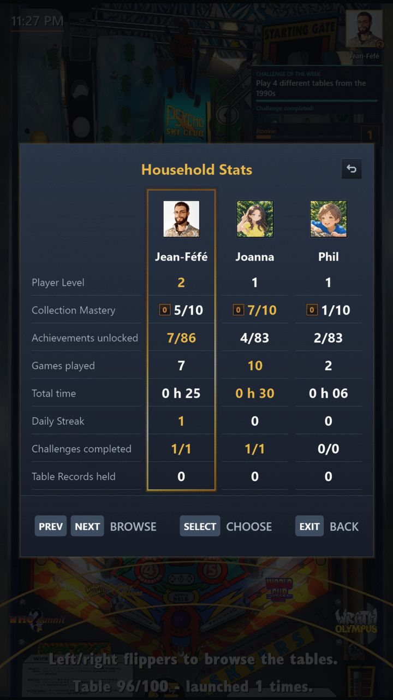

### Écran d'accueil : table du jour, table de la semaine

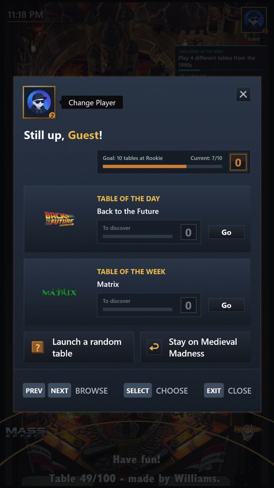

Chaque jour une table que personne à la maison n'a encore jouée, ou celle délaissée depuis le plus longtemps, chaque semaine une table au hasard. L'écran d'accueil vous les présente au démarrage, après chaque « Changer de joueur », et chaque fois que vous choisissez **Écran d'accueil** dans le menu principal, avec ce qu'elles représentent pour vous, et avec l'une de vos tables du défi tirée au hasard tant que votre défi de la semaine en a : lancez l'une d'elles, restez sur la table de la roue, changez de joueur ou tentez une table au hasard. Cette table du défi n'est jamais l'une des deux tables déjà présentées, sauf quand une partie de plus termine votre défi. Jouez-les plusieurs jours ou plusieurs semaines d'affilée pour faire une série. Tant que l'écran d'accueil ou « Changer de joueur » sont ouverts, le son des vidéos de la table de la roue est baissé, et revient à leur fermeture.

### Défis de la semaine

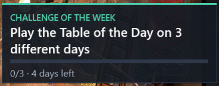

Chaque lundi arrive un nouveau Défi, le même pour toute la maison : cinq tables Stern différentes, trois tables jamais jouées, une demi-heure sur une même table… Sa carte suit votre progression sur l'écran de la roue. **Tables du défi**, juste sous « Toutes les tables » derrière « Changer de filtre » dans le menu principal, ne garde que les tables qui le font avancer, et quitte la liste quand il n'y en a plus. Le réussir fait pleuvoir des confettis sur tout l'écran de la roue.

### Maîtrise des tables

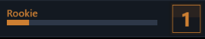

Chaque minute passée sur une table fait monter votre maîtrise de celle-ci, sur dix niveaux, de Novice à Mage du flipper, chacun plus long à atteindre que le précédent. La barre de maîtrise, en haut à droite de l'écran de la roue, montre où vous en êtes sur la table sélectionnée, et un encart annonce le niveau atteint. Quand dix de vos tables atteignent le niveau suivant, la maîtrise de votre collection passe un palier. Le niveau 10 sur une table et chaque nouveau palier font pleuvoir des confettis. Chaque palier débloque aussi un cadre pour votre Avatar, de la Sylve enchantée à la Légende céleste : choisissez celui que vous portez dans **Mon profil**, sous **Cadre**. Jouez un jour de fête (Nouvel An, Nouvel An chinois, Saint-Valentin, Pâques, Halloween, Noël et cinq autres) et le cadre de ce jour vous appartient pour de bon, annoncé par un encart à votre retour sur la roue.

### Meilleurs scores

Quand vous entrez au tableau des meilleurs scores d'une table, la place est à vous : le pack relit le tableau avant et après chaque partie et, pour une partie d'au moins une minute, attribue chaque nouveau score au Profil qui jouait, quelles que soient les initiales tapées, les autres joueurs d'une partie à plusieurs compris. Un encart annonce votre meilleure place, ou le record et à qui vous l'avez pris. Quand quelqu'un d'autre vous prend un record, Invité compris, votre prochain écran d'accueil vous dit qui, une seule fois, pour que vous sachiez quel record reprendre. Les scores déjà au tableau au premier relevé, ceux d'usine compris, n'appartiennent à personne, et une remise à zéro de la ROM qui les ramène n'est jamais attribuée. Un meilleur score gagné le reste même chassé du tableau par des scores plus récents, et rapporte ses propres succès ; **Mon profil** montre les meilleurs scores et records que vous détenez encore, et **Stats de la maison** qui détient le plus de records. Les tables sans ROM (créations originales) comptent aussi : le pack lit leur tableau dans le dossier `User` de Visual Pinball X (`VPReg.stg`, ou le fichier texte que certaines tables y gardent), apprend où chaque table le range pendant sa première partie, et le passe à PinballY, pour que le DMD et la fiche de la table l'affichent aussi. Leur tableau apparaît dès qu'une telle table a été jouée avec le pack.

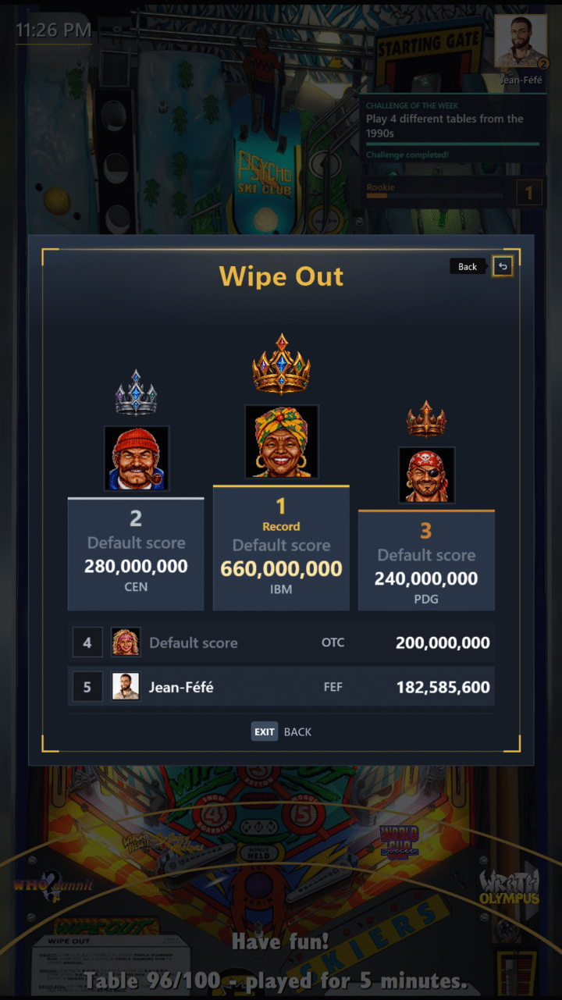

**Meilleurs scores** dans le menu principal (ou le bouton `HighScores` de PinballY, s'il est affecté) ouvre le tableau de la table sélectionnée, dessiné dans le style Steamball à la place de la fenêtre de PinballY : les trois premières places sur un podium sous une couronne d'or, d'argent et de bronze, les autres en lignes en dessous, chacune avec son rang, son score, ses initiales et le Profil qui l'a gagnée (nom, Avatar et cadre d'Avatar), ou « Score par défaut » avec un portrait choisi d'après ses initiales, le même sur toutes les tables. Le tableau est relu sur la table à chaque ouverture, il montre donc toujours ce qu'elle contient ; les flippers font défiler un tableau trop long pour l'écran.

### Succès

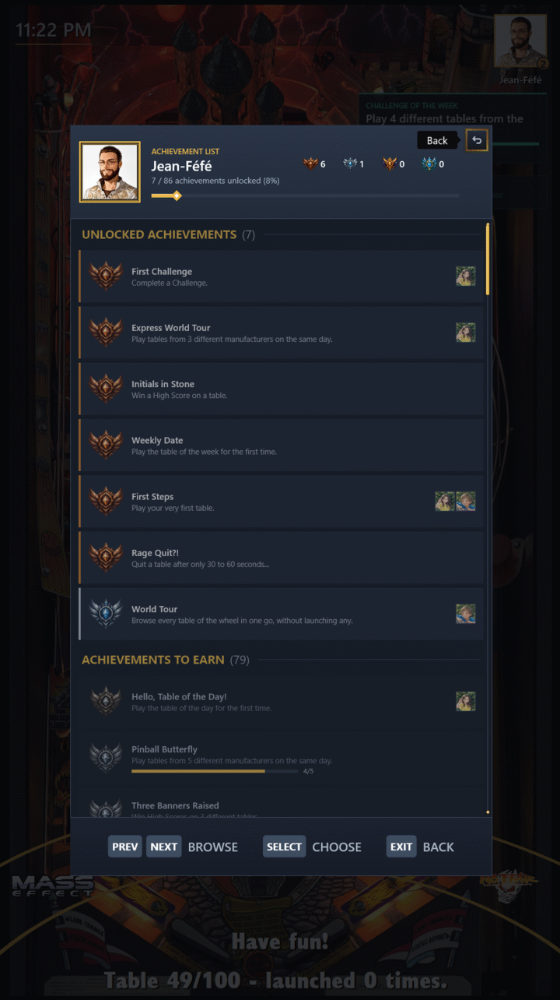

Des dizaines de Succès, du Bronze au Platine :
- fabricants et décennies complétés ;
- heures de jeu ;
- séries ;
- Défis ;
- tour complet de la roue…

Chacun est annoncé par un petit encart dans un coin, sans interrompre vos parties ; un Succès Platine fait aussi pleuvoir des confettis sur tout l'écran de la roue. « Succès personnels », ouvert depuis **Mes succès** dans le menu principal, montre où vous en êtes de chaque Succès manquant, et quels avatars de la maison l'ont déjà. Quelques-uns restent secrets : vous ne voyez que « ??? » et un indice, jusqu'à ce que vous tombiez dessus. Un Profil enfant en a trois de plus, rien qu'à lui : « L'heure du goûter », « Mercredi, c'est permis » et « Plus fort que les grands », un record de table pris à un grand.

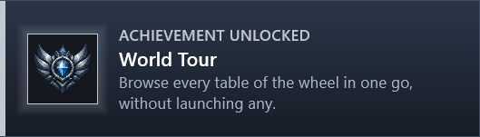

Chaque Succès rapporte des points à votre **niveau**, d'autant plus que son rang est élevé, sans dernier niveau. Il s'affiche en pastille sur votre Avatar, en bronze, puis en argent, en or et en platine à mesure que vous montez, et chaque nouveau niveau atteint a son encart et son feu d'artifice.

### Pour le propriétaire de la borne

- **Profil admin** : les entrées de configuration pour vous seul.
- **Profil enfant** : une roue sans tables pour adultes.
- **Réinitialiser un profil** : repartir de zéro, pour un Profil ou toute la maison d'un coup.
- **Nettoyage des menus** : des menus PinballY allégés.
- **Réglages du pack** : depuis le menu opérateur, activer ou désactiver chaque Add-on par catégorie, choisir l'écran de démarrage et la langue, puis redémarrer PinballY d'une pression.

Tout tient dans un seul dossier, sans modifier PinballY.

**Et aussi** :
- les menus de PinballY (menu principal, sortie, filtres, extinction, configuration de la table, menu opérateur, pause d'une partie, capture des médias, y compris par lot, et confirmations) et ceux des autres scripts, dessinés dans le style Steamball du pack, mêmes entrées, rangées en sections, et mêmes boutons ; dans la pause, Exit et « Annuler » reprennent la partie ; un menu principal plus court range toutes les sélections de la roue et les groupes de filtres derrière une seule entrée « Changer de filtre », et nomme sous sa liste le filtre affiché par la roue (« Filtre actif : Toutes les tables ») ;
- une table au hasard sur une roue de la fortune ;
- « Tables à découvrir », « Tables les plus jouées », « Mes meilleurs scores » (les tables où vous avez une place au tableau), « Tables favorites », « Tables masquées » (tant qu'une table est masquée) et « Tables Originales » derrière « Changer de filtre » ;
- une horloge, l'arc doré de la roue et une ligne d'état enrichie ;
- un rappel pour noter une table ;
- un lancement sans flash noir, avec une comète dorée qui tourne pendant l'attente, l'étape en cours écrite en doré dessous quand une table se lance ou se ferme (« Chargement en cours… », « Retour aux tables… ») : au lancement, au démarrage, pendant la lecture d'un tableau des scores et pendant la préparation des statistiques, de la liste des succès et de la liste des cadres d'Avatar ;
- le backglass masqué pendant une partie ;
- des sons au lancement, aux succès, à l'accueil, aux confettis et au feu d'artifice, ou les vôtres.

## À venir

Voici ce que nous envisageons pour la suite du pack. Rien n'est promis : les projets évoluent, et certaines de ces idées ne verront peut-être jamais le jour.

- **Year in Pinball** : le bilan de l'année de chaque Profil, les tables jouées et découvertes, les heures de jeu, les préférées, les succès et la plus longue série.
- **Thèmes** : d'autres styles que Steamball pour tous les écrans dessinés, avec un petit éditeur pour créer le vôtre.
- **Notes et favoris propres à chaque Profil**, puis la note moyenne de la maison pour chaque table.
- **Installation en 30 secondes et mises à jour**, sans git.

## Installation

Nécessite **Windows** et **PinballY 1.1.0 Beta 10** ou plus récent (plus la fonctionnalité facultative *Lecteur Windows Media*, pour les sons).

1. **Copiez le projet dans `PinballY\Scripts\ExpansionPack`**, sous ce nom exact : le pack y cherche ses fichiers. Depuis un zip téléchargé, renommez le dossier extrait (`PinballY-Expansion-Pack-main`) en `ExpansionPack` ; avec git, lancez `git clone https://github.com/F3L1X79/PinballY-Expansion-Pack.git ExpansionPack` depuis `PinballY\Scripts`.
2. **Ajoutez cette ligne à `PinballY\Scripts\main.js`**, ou créez le fichier avec cette seule ligne si vous n'en avez pas :
   ```js
   import "./ExpansionPack/main.js";
   ```
   Vos propres scripts continuent de fonctionner : rien d'autre n'est touché dans `Scripts`.
3. **Copiez `ExpansionPack\.env.example` en `ExpansionPack\.env.local`** et réglez ce qu'il vous faut, un `CLÉ=valeur` par ligne (UTF-8). Les réglages absents gardent leur valeur par défaut ; `.env.local` est ignoré par git.
4. **Facultatif : installez vpxtool**, pour que la ROM de chaque table soit remplie toute seule (Table ROMs). Téléchargez `vpxtool` pour Windows sur sa page de versions (https://github.com/francisdb/vpxtool/releases) et placez `vpxtool.exe` dans `ExpansionPack\tools` (à côté du programme de redémarrage déjà présent). Sans lui, la ROM d'une table est quand même trouvée, après sa première partie.
5. **Facultatif : passez PINemHi en 3.6.8**, pour que les meilleurs scores soient lus sur les tableaux d'environ 300 ROM de plus. Remplacez les fichiers de `PinballY\PINemHi` par ceux de PINemHi 3.6.8, puis **ajoutez toute la section `[romfind]` de son `romfind.ini` à la fin de son `pinemhi.ini`** (PinballY ne lit cette section que dans `pinemhi.ini` : sans elle, une table au champ ROM vide n'a plus aucun tableau), et réglez `USER=` dans `pinemhi.ini` sur le dossier `User` de Visual Pinball X.
6. **Redémarrez PinballY** et consultez `PinballY.log` : il liste vos réglages, une ligne « initialized » par add-on, et des lignes `ERROR` qui désignent l'add-on en cause.

Tout ce que le pack conserve reste dans `Scripts\ExpansionPack` : vos réglages (`.env.local`) et la progression de chaque Profil (`profiles`). **Pour sauvegarder**, copiez ce dossier. **Pour désinstaller**, supprimez-le et retirez la ligne d'import de `Scripts\main.js`.

## Réglages

Les réglages se trouvent dans `Scripts\ExpansionPack\.env.local`, un `CLÉ=valeur` par ligne. Les Add-ons, l'écran de démarrage et la langue se règlent aussi sans l'éditer, depuis **Réglages du pack** dans le menu opérateur. N'écrivez que ceux que vous changez, par exemple :

```
LANGUAGE=fr
ACHIEVEMENT_SOUND_FILE=assets\sounds\local\trophee.mp3
ADD_ON_CLOCK=false
```

| Réglage | Par défaut | Rôle |
|---|---|---|
| `LANGUAGE` | `en` | Langue : `en`, `fr`, `de`, `es`, `it` ou `pt`. |
| `ADULT_CATEGORY` | `NSFW` | Catégorie PinballY des tables pour adultes, cachées aux Profils enfant. |
| `COMMUNITY_TABLES_MANUFACTURER` | `VPX Community` | Fabricant donné aux tables fictives ou communautaires, pour la ligne d'état et le filtre « Tables Originales ». |
| `LAUNCH_SOUND_FILE` | `assets\sounds\launch.mp3` | Son joué au lancement d'une table : un chemin depuis le dossier du pack (vos sons vont dans `assets\sounds\local\`) ou un chemin complet ; vide = aucun son. |
| `ACHIEVEMENT_SOUND_FILE` | `assets\sounds\achievement.wav` | Son joué avec chaque annonce de Succès. |
| `PROFILE_GREETING_SOUND_FILE` | `assets\sounds\profile_greeting.mp3` | Son joué quand un joueur est accueilli. |
| `CONFETTI_SOUND_FILE` | `assets\sounds\confetti.wav` | Son joué une fois au début d'une pluie de confettis. |
| `FIREWORKS_SOUND_FILE` | `assets\sounds\fireworks.wav` | Son joué une fois au début du feu d'artifice. |
| `PROFILE_PICKER_SOUND_FILE` | vide | Son joué une fois quand PinballY démarre sur le carrousel « Changer de joueur » (`STARTUP_SCREEN=profilePicker`) ; aucun n'est fourni avec le pack. |
| `STARTUP_SCREEN` | `profilePicker` | Ce que PinballY montre en premier : `profilePicker` (le carrousel « Changer de joueur », puis l'écran d'accueil ; sauté tant que la borne compte moins de deux Profils en plus d'Invité), `welcome` (l'écran d'accueil) ou `wheel` (la roue seule, le dernier joueur salué). Un écran dont la fonctionnalité est désactivée cède la place au suivant, du carrousel à l'écran d'accueil puis à la roue. |
| `ACHIEVEMENT_TOAST_SECONDS` | `4` | Secondes d'affichage d'une annonce de Succès (60 au plus). |
| `ACHIEVEMENT_TOAST_SCALE` | `1.0` | Taille de l'annonce, de `0.5` à `3` : à augmenter sur un grand écran. |
| `CONFETTI` | `true` | `false` coupe la pluie de confettis qui accompagne l'annonce d'un Défi réussi, d'un Succès Platine, du niveau 10 de maîtrise sur une table ou d'un nouveau palier de la collection, si votre PC peine. |
| `FIREWORKS` | `true` | `false` coupe le feu d'artifice qui accompagne l'annonce d'un nouveau niveau, si votre PC peine. Indépendant de `CONFETTI`. |
| `SKIP_RANDOM_GAME_ANIMATION` | `false` | `true` saute la roue de la fortune et lance la table au hasard aussitôt. |
| `ASK_TO_RATE_AFTER_MINUTES_PLAYED` | `60` | Minutes jouées sur une table avant qu'on vous demande de la noter. |
| `LOG_UNTRANSLATED_MENU_TITLES` | `false` | `true` écrit chaque titre de menu PinballY non traduit dans `PinballY.log`. |
| `LOG_LAUNCH_EVENTS` | `false` | `true` écrit chaque événement de lancement dans `PinballY.log`, horodaté à la milliseconde, pour vérifier leur ordre sur la borne. |

Chaque fonctionnalité se désactive aussi avec sa clé `ADD_ON_*`, par exemple `ADD_ON_CLOCK=false` ou `ADD_ON_CHALLENGES=false`. Seul le nettoyage des menus est désactivé par défaut. Chaque clé est décrite dans [.env.example](.env.example).

La progression de chaque Profil est enregistrée dans `Scripts\ExpansionPack\profiles`. Gardez ce dossier quand vous réinstallez ou mettez à jour le pack, et vous retrouvez votre progression.

### Profil admin

Pour garder les entrées de configuration pour vous seul, ajoutez `"isAdmin": true` au premier niveau du `Scripts\ExpansionPack\profiles\<nom>\profile.json` de votre Profil, PinballY fermé. Dès qu'au moins un Profil est marqué, les autres Profils (Invité compris) ne voient plus « Configurer la table » dans le menu principal ni « Menu opérateur » dans le menu de sortie ; les Profils admin voient toujours les deux, et le bouton de service de la porte du monnayeur ouvre toujours le Menu opérateur pour tout le monde. Plusieurs Profils peuvent être marqués. Invité n'est jamais un Profil admin, et une marque qui n'est ni `true` ni `false`, ou dont la clé est mal écrite (`"isAdmin "`, `"IsAdmin"`), est ignorée et signalée dans `PinballY.log`.

Un Profil admin trouve aussi **Réinitialiser un profil** dans le menu de sortie (Échap), juste après « Menu opérateur ». Il liste tous les Profils, Invité et vous-même compris, plus « Tous les profils », dès qu'il y en a au moins deux, pour remettre toute la maison à zéro d'un coup. Après une confirmation (le curseur part sur « Non »), le Profil choisi repart de zéro : ses parties, ses séries, ses records de session, ses parties aléatoires, sa progression aux défis, ses succès annoncés, sa maîtrise des tables, son palier de collection et ses cadres d'Avatar sont effacés, tandis que son nom, son avatar, ses marques et les meilleurs scores qu'il a gagnés restent. Un message indique ensuite si l'opération a réussi. Ses anciens fichiers sont gardés à côté, sous les noms `profile.reset-<date>.json` et `play-log-<année>.reset-<date>.json` : pour annuler une réinitialisation, fermez PinballY et renommez chaque copie sans sa partie `.reset-<date>`. Cette entrée a besoin du menu de sortie de PinballY : si vous l'avez désactivé dans les options de PinballY, elle ne peut pas apparaître.

### Profil enfant

Pour tenir les tables pour adultes à l'écart d'un enfant, donnez-leur dans PinballY la catégorie `NSFW` (ou nommez votre propre catégorie avec `ADULT_CATEGORY` dans `Scripts\ExpansionPack\.env.local`, écrite exactement comme dans PinballY), puis ajoutez `"isChild": true` au premier niveau du `Scripts\ExpansionPack\profiles\<nom>\profile.json` de l'enfant, PinballY fermé. Tant que ce Profil est actif, ces tables n'apparaissent sur la roue sous aucun filtre, la partie aléatoire n'en tire jamais et le démarrage ne laisse jamais la roue sur l'une d'elles ; passer à un autre Profil les fait revenir aussitôt. La table du jour et la table de la semaine restent les mêmes pour toute la maison : tant que l'une d'elles est une table pour adultes, l'enfant n'a pas sa carte sur l'écran d'accueil, et ce jour ou cette semaine ne prolonge ni ne casse sa série. Invité n'est jamais un Profil enfant : les adultes de passage voient toute la collection. Ce n'est pas un contrôle parental : rien ne demande de mot de passe.

### Nettoyage des menus

Le nettoyage des menus allège les menus de PinballY pour tous les Profils, Profils admin compris : il retire Aide et À propos des menus de sortie et opérateur, Informations, Affiche et Carte d'instructions du menu principal (Noter la table et Ajouter aux favoris restent), l'entrée Meilleurs scores de PinballY (nommée **Scores de la table** dans le menu principal) quand les meilleurs scores du pack sont désactivés, et les groupes Filtrer par système, Filtrer par dernière partie et Filtrer par date d'ajout de « Changer de filtre ». C'est la seule fonctionnalité **désactivée par défaut** : activez-la avec `ADD_ON_MENU_CLEANUP=true`. Les boutons dédiés de PinballY pour ces écrans, si vous les avez affectés, fonctionnent toujours.

## Contribuer

Organisation du code, conventions, tests, ajout d'une langue et remise à zéro de la progression : voir le [guide du contributeur](CONTRIBUTING.md) (en anglais).

## Licence

MIT. Voir [LICENSE](LICENSE).
